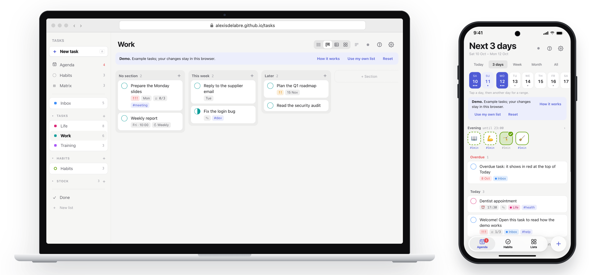

# Tasks

A small task app on one markdown file in a GitHub repository. Static files, no build, no server, no account. Open it to try the demo: https://alexisdelabre.github.io/tasks/

## What it does
Views: Today, Next 7 days, All, and Matrix (urgent × important). Each list has List, Board, Lanes and Matrix views, with sections. Quick add reads a sentence such as `Call the bank tomorrow 9am every week #money !1 @Life`, in English or French. Tasks have notes, checklists, priority, tags, repeats (`week`, `mon,thu`, `1mon`, `-1fri`…) and an In progress state. A habits list (`## Habits ~habits`) keeps a streak per habit and never marks a missed one overdue. A stock list (`## Groceries ~stock`) holds things you buy again, with a shopping mode. A stickies list (`## Stickies ~stickies`) holds things not to forget, with an optional deadline (`by:2026-10-29`, `~firm` when it must not pass, `lead:7d` to act a week before), shown on a horizon line in the Agenda. A task can carry a window: it starts at its date and time, ends at `by:2026-10-14T23:00`, should be done `lead:2h` before that, and takes `est:20m`; the app shows a window bar and warns when the window is too short. Phone reminders come from a GitHub Action and [ntfy](https://ntfy.sh).

## The file
Each `## heading` is a list, each `### heading` a section. One task per line: `- [ ] Title due:2026-10-20 at:18:00 every:week !1 #tag ^id`. Notes and checklist items sit under the task, indented by two spaces. See `demo.md` for every feature. The app keeps every line it does not change, so you can also edit the file by hand, in Obsidian, or with an AI agent.

## Use your own list
1. Create a private repository with a `Tasks.md` at its root. Start from `demo.md` or from one line, `## Inbox`.
2. Create a fine-grained token: Only select repositories → that repository; Permissions → Contents: Read and write.
3. Open the app, then Settings. Paste the token, the repository (`owner/name`), the branch and the file path. The token stays in your browser and goes only to GitHub.

## Phone reminders
1. Install the ntfy app and subscribe to a long random topic name. Anyone who knows the name can read it.
2. Copy `reminders/notify.mjs` and `reminders/core.mjs` into `reminders/` of your tasks repository, and `reminders/tasks-reminders.yml` into `.github/workflows/`.
3. Add the repository secret `NTFY_TOPIC`. Set your time zone and digest hour in the workflow file.

A task with a time sends a notification at that time. A task with a date and no time shows in the morning digest. The job runs after each change to `Tasks.md` and every 6 hours, and it schedules reminders up to 3 days ahead.

This repository is a deploy target: the source lives in a private repository.
